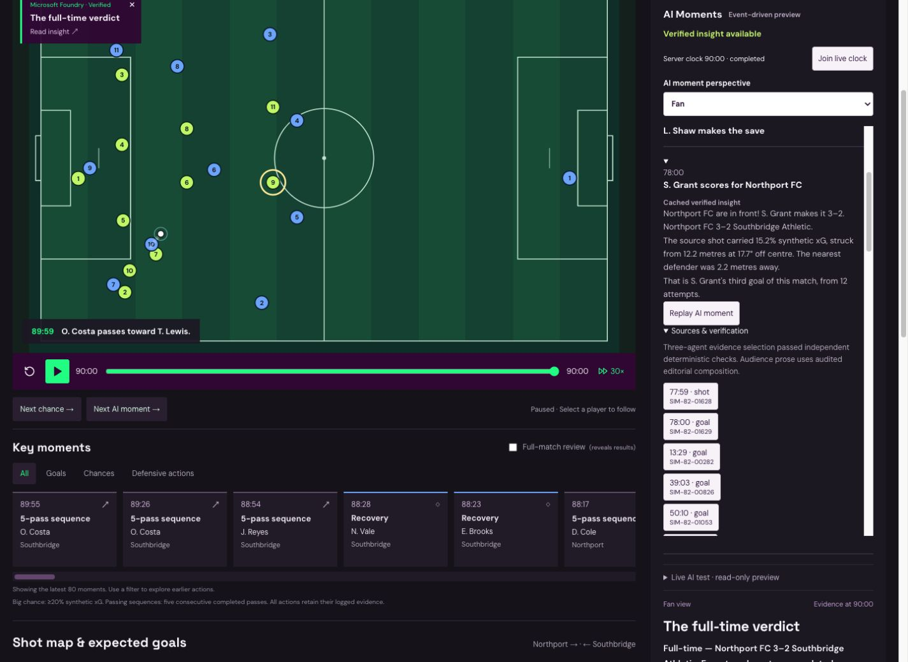
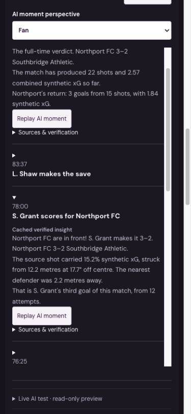

# October 24 Azure rollout — genuine event-driven session

The public [TacticLens website](https://cookiesgobrr.github.io/tacticlens-live/?seed=82&tour=off) now reads the completed `live-20261024-82` session from the existing Azure Function App. Open **AI Moments** and select **Join live clock** to inspect the completed history, perspectives, source evidence and replay.

Nine new moments completed real Microsoft Foundry Insight, Verification and Presentation agents and passed the independent evidence gate. This was not timed playback of precomputed JSON. The server timer selected actual events from the approved engine source and submitted new inference. After the final fix, eight consecutive workflows succeeded through full time. Generation and the timer were then disabled; visitors now consume the verified results without starting inference.

This was an accelerated, operator-supervised test with two pauses for fixes. It is not evidence of a clean, uninterrupted 90-minute service or unrestricted public generation. Five earlier moments failed closed and retain factual fallback coverage in history. Their reservations were retained and their events were never retried.

## Genuine usage and latency

| Measurement | Observed result |
| --- | --- |
| Actual model calls / provider responses | 34 / 34 |
| Input / output tokens, including rejected attempts | 32,558 / 1,871 |
| Verified moments / rejected moments | 9 / 5 |
| Reserved calls / maximum approved calls | 42 / 45 |
| Reserved allocation / maximum approved allocation | $0.882 / $1.00 |
| Mean workflow time | 4.36 seconds |
| Mean / maximum event-to-publication time | 7.06 / 11.52 seconds |
| Calls after audience switching, replay and refresh | 34, unchanged |

The existing GPT-4.1-mini deployment is GlobalStandard, version 2025-04-14. At the [published Azure Global rates](https://azure.microsoft.com/en-us/pricing/details/azure-openai/) of $0.40 per million input tokens and $1.60 per million output tokens, the recorded inference usage estimates to **$0.0160168**. This is a token-based estimate, not a settled Azure invoice or exact credit debit. Azure's credit and cost dashboards lag. The private operating attestation used more conservative price ceilings and a credit haircut. No private approval, account balance, key or credential is included here.

| Simulation time | Event ID | Type | Workflow / event-to-publication |
| --- | --- | --- | --- |
| 35:59 | SIM-82-00756 | Defensive intervention | 5.755s / 11.068s |
| 45:00 | SIM-82:halftime | Halftime | 5.000s / 6.606s |
| 50:10 | SIM-82-01053 | Goal | 4.935s / 6.212s |
| 53:21 | SIM-82-01114 | Defensive intervention | 3.707s / 4.048s |
| 64:23 | SIM-82-01338 | Save | 3.084s / 5.921s |
| 76:25 | SIM-82-01597 | Goal | 5.487s / 9.251s |
| 78:00 | SIM-82-01629 | Winning goal | 4.645s / 11.520s |
| 83:37 | SIM-82-01740 | Save | 3.025s / 3.779s |
| 90:00 | SIM-82:fulltime | Full time | 3.568s / 5.175s |

The winner's actual provider response IDs are available under its Sources & verification panel:

- Insight: `resp_07299d07b60aadf3016adc8200de308194ae0d7a6cf3c3e1b3`
- Verification: `resp_09a2847516f795d5016adc820261c48190b30ed5056a8a4c44`
- Presentation: `resp_059c4ab3a3003c74016adc820357188193bc73b7fb41b04362`

The winner retains shot `SIM-82-01628`, goal `SIM-82-01629`, the original 78:00 timestamp, prefix 20 shots / approximately 2.41 combined synthetic xG, and full-time 22 shots / approximately 2.57 xG. Original engine, seven-moment showcase and October 23 publication hashes are unchanged.

## Scope, controls and validation

The architecture supports approved classic and formation-v2 seeds; the genuine Azure test used seed 82 only. Population and Python/TypeScript parity tests cover additional seeds offline. The maximum is 15 reserved moments / 45 calls per match; significance, event availability, queue pressure and failures can reduce publication counts.

Commentary uses **constrained editorial composition**: real agents select the angle, evidence and audience-specific lead/context/support slots; audited original grammar renders the prose. It is not unrestricted model-authored commentary. All editions share one verified analysis and switching editions submits no inference.

The existing Function App, Foundry deployment, managed identity and private Blob container were reused. No persistent resource, subscription upgrade, role grant or public model credential was added. A finite private approval and public read allowlist, durable ETag accounting, one active session/workflow, strict token limits, zero SDK retries, $1 daily allocation and $190 reserve guard remain in force. Fresh hosted ARM checks require an enabled FreeTrial with spending limit On before each workflow. Failed workflows pause dispatch automatically. Operator continuation preserves the same clock, source, deduplication and all reservations.

Validation includes 101 backend tests, real SDK MockTransport tests, 100-seed event detection, cross-runtime fact parity, existing simulation/browser suites and an offline HTTP/React two-event flow. Those offline tests use mocks and consume no Azure inference. The nine moments above are genuine Azure inference. Actual cloud-browser review additionally checked source-linked Fan/Analyst/Broadcast switching, replay, refresh, 320/390/1440px layout and 2D/3D clock/score parity. The durable call counter remained 34 after those cache operations.

Implementation PRs: [#42](https://github.com/Cookiesgobrr/tacticlens-live/pull/42), [#43](https://github.com/Cookiesgobrr/tacticlens-live/pull/43), [#44](https://github.com/Cookiesgobrr/tacticlens-live/pull/44). Final implementation CI: [Verify TacticLens](https://github.com/Cookiesgobrr/tacticlens-live/actions/runs/40083924487). The deployed Azure package corresponds to commit `1aee47bbffa54a60e3bc18d458ab3473ca4da6de`, merged as `6b2ffbd8868eec3cb9dc300f6fc40a20e8998675`.

## Actual website review

Desktop winner card alongside the football experience:

Mobile history and winner card:

